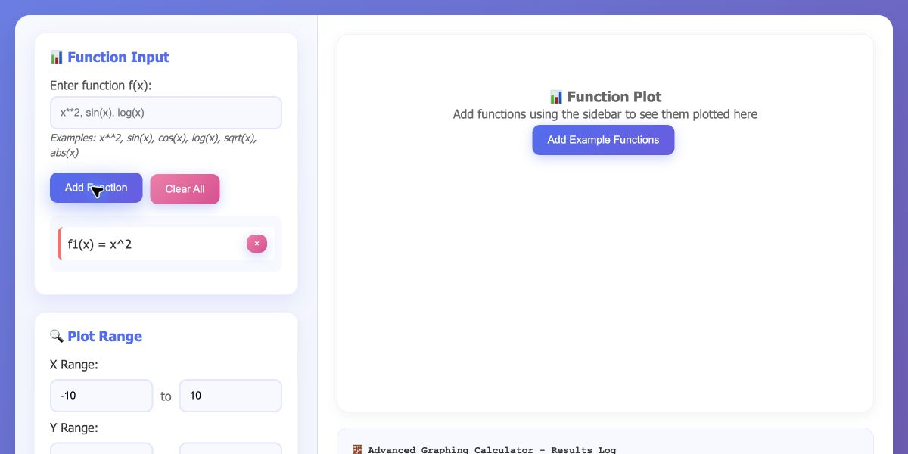

# College Algebra Projects

Five Python learning tools for algebra, graphing, data exploration, finance, and math games.

## Setup

```sh
python -m venv .venv
source .venv/bin/activate
python -m pip install -r requirements.txt
```

| Tool | Launch |
|---|---|
| Web graphing calculator | `python graphing_calc.py`, then open `http://127.0.0.1:5000` |
| Finance calculator | `python FinCalc.py` |
| Data exploration | `python datagraphExplorer.py` |
| Algebra and number conversions | `python multiFuncCalc.py` |
| Desktop math games | `python 3mathgames.py` |

## Checked status

The graphing page rendered locally; adding a function, solving a quadratic, and a zero-interest mortgage calculation passed offline checks. The remaining interactive menus and desktop games were not fully exercised.

The web calculator uses in-memory state and symbolic expression parsing. Run it locally with trusted inputs; public multi-user hosting needs a separate security and persistence review. Debug mode is disabled by default.

[Detailed project notes](docs/project-guide.md)


